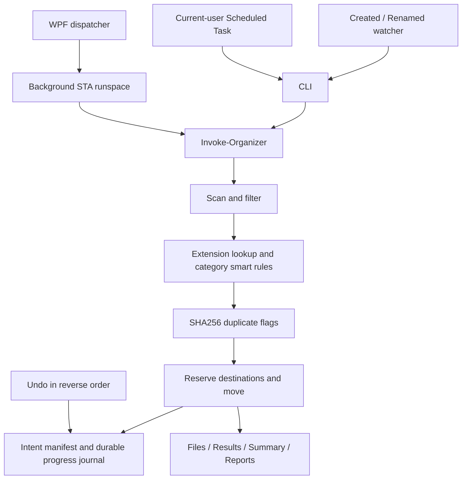

# Architecture

The aggregate [manifest](../DownloadOrganizerPro.psd1) defines version 2.2.0 and Windows PowerShell 5.1 compatibility. It imports 18 implementation modules, with explicit internal imports and no forced reimports that reset watcher state.

`Invoke-Organizer` accepts effective Config, DownloadsPath, OperationalPath, optional ConflictAction, and an optional progress queue. It returns Files, Results, Summary, Reports, and LogFile. The CLI handles console output; `Show-OrganizerSummary` returns formatted text.

Models define Pending, Moved, Failed, Skipped, and Planned. Result objects preserve File, Category, SubCategory, Status, and Destination, adding Reason, IsDuplicate, and SHA256Hash. Summary adds Planned and Duplicates to its existing fields. Extension lookup and smart patterns are built once per invocation; filename reservations share a batch cache.

The mover normalizes source/destination paths, rejects reparse points, checks destination containment, and compares source and destination before conflict resolution. Windows paths are compared case-insensitively. File moves use literal .NET APIs that refuse to replace an occupied file. A Local named mutex derived from the normalized folder coordinates organizer and Undo across processes; OS mutex lifetime permits restart after a crash.

Version 2 transactions contain all intents before mutation, unique IDs, source hashes, backup references, and expected backup hashes. Appended `.progress` records are flushed to disk for each safety transition. Recovery checks disk contents and replays progress; a torn final journal append can be discarded. Partial Undo records SourceReturned and Undone independently, so retry does not repeat completed moves. Completed transactions are archived. Legacy manifests are read conservatively; they lack content fingerprints.

The GUI template is [OrganizerWindow.xaml](../assets/OrganizerWindow.xaml). Workers enqueue progress and return the shared result contract; a dispatcher timer updates controls. Closing waits for an active worker. The grid shows at most 500 results while reports retain all rows.

Watcher state belongs to its module. Event contexts use MessageData, debounce bursts, and check size/write-time stability and readability before starting a hidden worker. Scheduler uses ScheduledTasks objects, separate executable/arguments, Interactive current-user logon, and Limited run level. The portable C# launcher forwards quoted arguments and applies its GUI mutex only to GUI launches.
